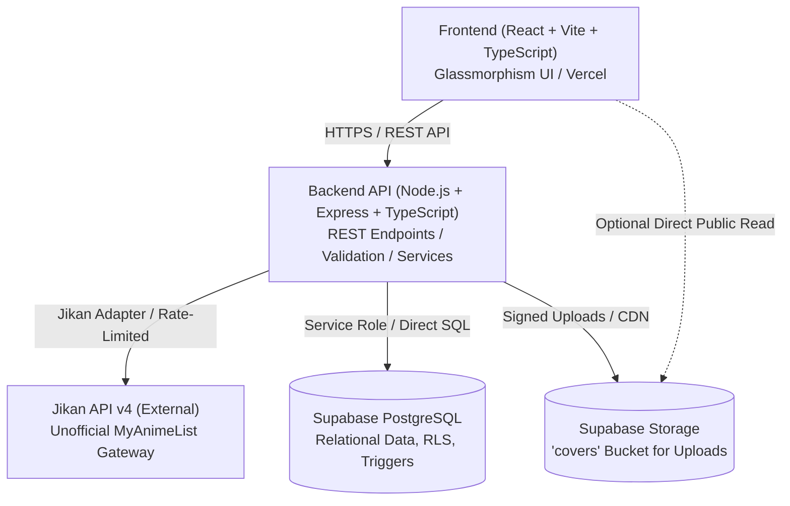
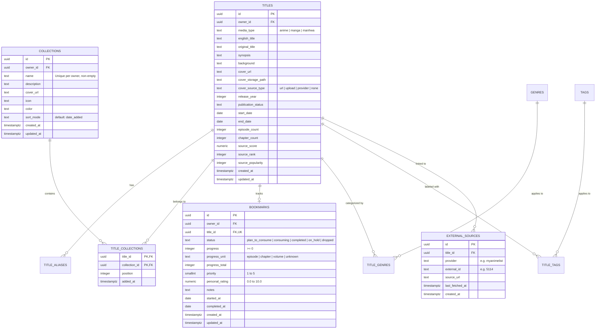
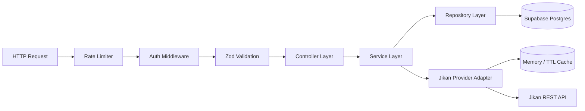
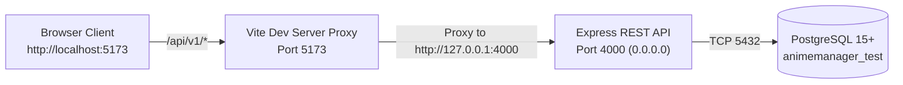
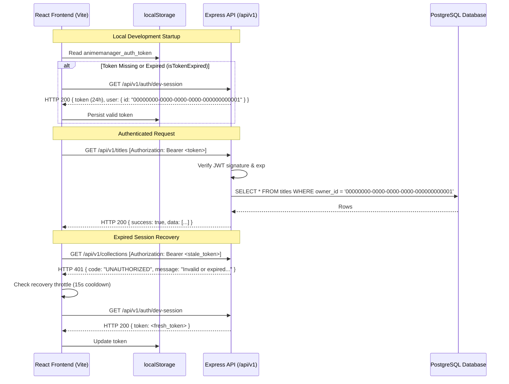

# AnimeManager — System Architecture

**Document Version:** 1.8
**Status:** Authentication, JWT Lifecycle & Protected Workflow Architecture Complete (Phase 05.2)
**Implementation State:** Phases 01, 02, 03, 04, 05, 05.1, and 05.2 Complete (PostgreSQL Schema, Express REST API, Resilient Jikan Adapter, React Vite Glassmorphism Shell, TanStack Query API Client, AuthProvider, Title CRUD & Detail View, Collections & My List, Bookmarks & Progress Tracking, Jikan Import UI, JSON/CSV Export Endpoints, Concurrent Development Runner, Healthcheck Suite, Guarded Dev Session Management, Client Expiry Pruning)
**Next Phase:** Phase 06 Hardening: Security, Accessibility, & Performance (Pending user review and authorization)

---

## 1. System Overview

AnimeManager (Personal Media Library) is designed as a private-first personal catalog and tracker for anime, manga, and manhwa. The system separates **Bookmarks** (user's consumption status, episode/chapter progress, rating, and notes) from **My List** (arbitrary user-defined thematic collections and folders).



### Key Architectural Tenets
1. **Separation of Concerns:** Business logic lives in backend services; UI components handle presentation and user interactions; database maintains referential integrity through foreign keys and constraints.
2. **Private-First Security:** The application is not an open public social platform. Access is restricted to the library owner; database tables enforce Row Level Security (RLS) or explicit backend authorization gates.
3. **Resilient Metadata Import:** External services (Jikan/MyAnimeList) can fail, be rate-limited, or change. All imported data passes through an editable preview draft before persistence, and manual entry remains fully functional independently.
4. **Data Ownership & Portability:** All metadata, collections, and progress records reside in the user's PostgreSQL database with full JSON and CSV export capabilities.

---

## 2. Monorepo Repository Structure

The project adopts a structured monorepo layout using npm workspaces:

```text
AnimeManager/
├── apps/
│   ├── web/                         # Frontend Application (React, Vite, TS)
│   │   ├── src/
│   │   │   ├── app/                 # Root app component, router, providers
│   │   │   ├── components/
│   │   │   │   ├── layout/          # Shell, Navigation, Header, MobileNav
│   │   │   │   ├── ui/              # Glassmorphism buttons, cards, dialogs, inputs
│   │   │   │   ├── media/           # Poster cards, media badges, cover artwork
│   │   │   │   ├── collections/     # Collection cards, pickers, managers
│   │   │   │   ├── bookmarks/       # Status tabs, progress sliders, rating stars
│   │   │   │   ├── forms/           # Manual title form, collection form
│   │   │   │   └── import/          # Jikan search, preview, field selector
│   │   │   ├── features/            # Feature modules (titles, collections, bookmarks, search)
│   │   │   ├── hooks/               # Custom React hooks
│   │   │   ├── lib/                 # API client, query client, utilities
│   │   │   ├── styles/              # Design tokens, glassmorphism CSS, animations
│   │   │   └── types/               # Frontend-specific types
│   │   ├── index.html
│   │   ├── package.json
│   │   └── vite.config.ts
│   │
│   └── api/                         # Backend REST API (Node.js, Express, TS)
│       ├── src/
│       │   ├── app.ts               # Express application setup & middleware
│       │   ├── server.ts            # HTTP server entry point
│       │   ├── config/              # Environment variables & runtime validation
│       │   ├── routes/              # Express route definitions
│       │   ├── controllers/         # HTTP request/response handlers
│       │   ├── services/            # Core business logic
│       │   │   ├── titles/          # Title creation, update, query logic
│       │   │   ├── collections/     # Collection & membership logic
│       │   │   ├── bookmarks/       # Bookmark & progress tracking logic
│       │   │   └── import/          # Jikan adapter, normalizer, draft preview
│       │   ├── repositories/        # Database queries (Supabase client/pg)
│       │   ├── middleware/          # Validation, error handling, auth, rate limiting
│       │   ├── schemas/             # Zod validation schemas
│       │   └── errors/              # AppError classes & error catalog
│       ├── package.json
│       └── tsconfig.json
│
├── packages/
│   └── shared/                      # Shared types, constants, and Zod schemas
│       ├── src/
│       │   ├── types/               # Title, Bookmark, Collection, Jikan types
│       │   ├── schemas/             # Shared validation schemas
│       │   └── constants/           # Status enums, media type enums
│       ├── package.json
│       └── tsconfig.json
│
├── supabase/
│   ├── migrations/                  # Versioned SQL migrations (schema, RLS, triggers)
│   ├── seed.sql                     # Development seed fixtures
│   └── config.toml                  # Supabase local CLI configuration
│
├── docs/                            # Project documentation & build tracking
│   ├── BUILD_PROGRESS.md
│   ├── architecture.md
│   ├── api-contracts.md
│   ├── decisions.md
│   ├── test-report.md
│   ├── requirements-traceability.md
│   ├── deployment.md
│   └── known-limitations.md
│
├── Documentations/                  # Original client prompt and specifications (Immutable)
├── .env.example                     # Environment template with safe placeholders
├── .gitignore                       # Standard version control ignore rules
├── package.json                     # Root monorepo workspace configuration
└── README.md                        # Project onboarding and developer documentation
```

---

## 3. Data Architecture & Database Schema

The database is built on **Supabase PostgreSQL**. Relational integrity, check constraints, foreign keys with cascade deletions, and automated timestamps are enforced at the database layer.



### Constraints & Indexes
- `media_type`: Check constraint in `('anime', 'manga', 'manhwa')`.
- `bookmark.status`: Check constraint in `('plan_to_consume', 'consuming', 'completed', 'on_hold', 'dropped')`.
- `bookmark.progress`: Non-negative integer check (`progress >= 0`).
- `bookmark.personal_rating`: Numeric check between `0.0` and `10.0`.
- Unique constraint on `(owner_id, title_id)` on `bookmarks` (one bookmark per title per user).
- Unique constraint on `(owner_id, lower(name))` on `collections` (prevents case-insensitive duplicate names).
- Composite primary key on `title_collections(title_id, collection_id)`.
- Unique constraint on `(provider, external_id)` on `external_sources`.
- Trigram / B-tree indexes on `titles(english_title)`, `title_aliases(alias)`, `bookmarks(owner_id, status)`, `titles(owner_id, media_type)`.

---

## 4. Backend Architecture (Express API)

The backend follows a layered architecture to maintain clear boundaries:



### Layers (Implemented in Phase 02):
1. **Routing & Middleware (`apps/api/src/middleware/`):**
   - Helmet security headers with restrictive CSP policies, CORS configured via environment variables.
   - Request ID attribution via `request-id.middleware.ts` generating or preserving `X-Request-ID`.
   - Authentication middleware (`auth.middleware.ts`) verifying Supabase JWT tokens via `jsonwebtoken` against `SUPABASE_JWT_SECRET`. Rejects missing, malformed, invalid, or expired tokens with HTTP 401. Derives authenticated `owner_id` and attaches to `req.user`.
   - Zod validation middleware (`validation.middleware.ts`) validating request `body`, `query`, and `params` against Zod schemas, returning standard HTTP 422 `VALIDATION_ERROR` envelopes.
   - Centralized error handler (`error.middleware.ts`) mapping `AppError` subclasses (`ValidationError`, `UnauthorizedError`, `ForbiddenError`, `NotFoundError`, `ConflictError`, `DatabaseError`) to stable error codes, suppressing stack traces and sensitive connection strings in production.
2. **Controllers (`apps/api/src/controllers/`):**
   - Pure request/response handlers: `health.controller.ts`, `titles.controller.ts`, `collections.controller.ts`, `bookmarks.controller.ts`.
   - Formats responses using standard JSON envelope `{ data, meta }` or `{ data, pagination, meta }`.
3. **Services (`apps/api/src/services/`):**
   - Core domain business logic and validation: `titles.service.ts`, `collections.service.ts`, `bookmarks.service.ts`.
   - Strictly enforces owner isolation; guarantees cross-owner titles cannot be attached to another user's collection or bookmarked.
   - Enforces progress bounds (`0 <= progress <= progressTotal`) and personal rating bounds (`0.0 <= personalRating <= 10.0`).
4. **Repositories (`apps/api/src/repositories/`):**
   - Database connection pooling managed via `db.ts` with `pg.Pool`.
   - Fully parameterized queries protecting against SQL injection.
   - `db.transaction()` executes multi-table mutations (such as title creation with aliases, genres, and tags) inside atomic transactions, rolling back upon error.
   - `titles.repository.ts`, `collections.repository.ts`, `bookmarks.repository.ts` manage relational SQL operations.
5. **Jikan Adapter (`apps/api/src/services/import/`):**
   - Implemented in Phase 03:
     - `url-parser.ts`: Strict SSRF-safe URL parser for MyAnimeList URLs (`https://myanimelist.net/anime/{id}` and `/manga/{id}`). Validates protocol, hostname, port, and path shape.
     - `cache.ts`: `BoundedTtlCache` implementing TTL expiration (10m default) and LRU eviction (500 entries max) to prevent unbounded memory growth.
     - `throttler.ts`: `RequestThrottler` enforcing ~3 req/s spacing between outbound upstream requests.
     - `jikan.client.ts`: Resilient HTTP client with bounded exponential backoff for HTTP 429 and 503, honoring `Retry-After`, 10s request timeout, `redirect: 'error'`, non-retryable 4xx rejection, and test fetch injection hooks.
     - `normalizer.ts`: Maps upstream payloads into domain `ImportDraft`. Classifies explicit manhwa, flags ambiguous manga/manhwa with warnings and `needsMediaConfirmation`, deduplicates aliases/genres/tags, and strictly excludes community reviews.
     - `import.service.ts`: Orchestrates candidate search, read-only preview with duplicate detection against `external_sources`, and atomic transactional commit enforcing server-side field selection.

---

## 5. Frontend Architecture (React + Vite)

### Technology Stack:
- **Core:** React 18+, Vite, TypeScript.
- **Routing:** React Router v6+.
- **State & Caching:** TanStack Query (React Query) for server state (Phase 05); local React state with URL search parameter synchronization (`useSearchParams`) for catalog filtering and search.
- **Forms & Validation:** React Hook Form with `@hookform/resolvers/zod`.
- **Icons:** Lucide React.
- **Styling:** Vanilla CSS with design tokens and CSS custom properties (glassmorphism tokens, backdrop filters, translucent surfaces, and accessibility contrast fallbacks).

### Key Components & Catalog Architecture (Phase 04 Part 2):
1. **Demonstration Dataset (`apps/web/src/data/demo.ts`):**
   - Single source of truth for demonstration records prior to Phase 05 API integration.
   - Contains 12 typed sample records (`DEMO_TITLES`) balanced evenly across anime (4), manga (4), and manhwa (4), with stable identifiers (`demo-*`), ratings, release years, genres, and bookmark statuses.
   - Decoupled from backend persistence: purely functional query utilities (`searchTitles`, `filterByMediaType`, `filterByBookmarkStatus`, `sortTitles`, `countByStatus`).
2. **Interactive UI Components (`apps/web/src/components/ui/`):**
   - `FilterChips`: Accessible pill-shaped filter controls using radiogroup/radio ARIA bindings, active state glow, count badges, and horizontal touch scrolling.
   - `SortControl`: Accessible custom sort component combining a styled glassmorphic trigger with an overlay native `<select>` element for seamless keyboard and screen-reader accessibility.
   - `AddTitleModal`: Non-persistent preview dialog demonstrating the planned manual entry form with clear Phase 05 preview disclosures, disabled submit button ("Save Title (Phase 05)"), and native dialog focus management.
   - `PosterCard`: Enforces 2:3 aspect ratio, displays title, media badge, rating, and status label. Features `imgFailed` state fallback rendering a styled gradient with title initials when cover images fail to load.
3. **Search & URL Synchronization:**
   - Global header search form in `Header.tsx` navigates to `/titles?q=${query}` upon submission.
   - `TitlesPage.tsx` synchronizes query state with `useSearchParams`, providing real-time substring search, instant clear button, media-type filtering, multi-facet sorting, and empty/no-results states.
4. **Tracking & Collection Boundaries:**
   - `BookmarksPage.tsx` provides functional status tabs (`consuming`, `plan_to_consume`, `completed`, `on_hold`, `dropped`) with live count tallies and per-status empty states.
   - `MyListPage.tsx` is clearly defined as the user's organizational system (folders and multi-collection memberships).
   - `CollectionsPage.tsx` manages thematic curations with starter theme inspiration and a non-persistent preview modal.

### Key Pages & Navigation:
- **Primary Routes:**
  - `/` — Library Dashboard (Quick stats, spotlight hero cards, category-filtered showcase, library navigation shortcuts).
  - `/titles` — Complete Title Catalog (Interactive search, media filters, sorting controls, responsive poster grid).
  - `/bookmarks` — Bookmarks Tracker (Status tabs: All, In Progress, Plan to Watch, Completed, On Hold, Dropped).
  - `/my-list` — My List Overview (Folder and collection organization).
  - `/collections` — Custom Thematic Collections (Curated groupings and theme ideas).
  - `/import` — Jikan Importer UI (Search MyAnimeList and import preview).
  - `/settings` — Preferences, JSON/CSV export, health status (Phase 05 disclosures).
  - `*` — NotFoundPage (404 error page).

---

## 6. Jikan Integration & SSRF Protection

### URL Safety Architecture & SSRF Defenses:
To eliminate Server-Side Request Forgery (SSRF) vulnerabilities, the application **never** performs direct HTTP fetches of user-supplied URLs or passes user input to fetch handlers:
1. **Strict WHATWG URL Parsing:**
   - URLs are parsed using the standard WHATWG `URL` class (`apps/api/src/services/import/url-parser.ts`).
   - Rejects non-HTTPS protocols (`http:`, `ftp:`, `file:`, `javascript:`, etc.).
   - Exact hostname validation: Hostname must be strictly `myanimelist.net`. Alternate domains, lookalikes (`myanlmelist.net`, `myanimelist.net.evil.com`), IP addresses (`127.0.0.1`, `169.254.169.254`, IPv6 `::1`), and localhost are rejected with HTTP 400.
   - Enforces default port 443 (or empty port); rejects URLs with custom ports (`:8080`, `:22`).
   - Rejects URLs containing authentication credentials (`user:pass@...`).
   - Pathname validation: Must strictly match `^\/(anime|manga)\/(\d+)(?:\/[^\/]+)?\/?$`. Only positive numeric IDs are accepted.
   - Trailing slashes are permitted, optional title slugs are safely parsed, and query parameters (`?query=...`) and hash fragments (`#fragment`) are safely discarded without altering the parsed ID or media type.
2. **Fixed Upstream Base URL Construction:**
   - Outbound HTTP requests are built strictly from the immutable constant `https://api.jikan.moe/v4/{endpoint}`.
   - Client-supplied URLs are never passed to the HTTP client.
   - Client redirect policy: `redirect: 'error'` ensures the HTTP client refuses to follow automatic redirects to arbitrary hosts.

### Import Resilience & Upstream Protection:
- **Timeouts:** Configurable request timeout with 10-second default using `AbortSignal.timeout(10000)`.
- **Request Throttler:** `RequestThrottler` enforces a serialized inter-request delay (~334ms spacing, ~3 req/s) to comply with Jikan's published rate limits.
- **Bounded In-Memory Caching:** `BoundedTtlCache` stores successful candidate search and full detail responses (10m TTL default) with LRU capacity eviction (500 entries max) to prevent unbounded memory growth. Failed requests are never cached as successes.
- **Transient Error Retries:** Bounded exponential backoff (initial delay 500ms, backoff factor 2, max 3 retries, capped at 10s wait) applies exclusively to transient HTTP 429 (Too Many Requests) and HTTP 503 (Service Unavailable).
- **`Retry-After` Header:** Honors standard numeric seconds and HTTP-date formats up to the maximum bounded wait time.
- **Non-Retryable Errors:** Client errors (400, 404, etc.) fail immediately without retries.
- **Decoupled Architecture:** If Jikan is unavailable, manual title creation, collection management, and bookmark tracking remain completely operational without interruption.

### Upstream Network Error Classification & Diagnostics (Phase 05.3):
- **8-Category Error Taxonomy:** `jikan.client.ts` implements `classifyNetworkError(err)` to inspect `err.code`, `err.name`, and underlying `err.cause` (including `Undici` and Node.js network errors):
  - `UPSTREAM_DNS_ERROR`: Host resolution failures (`ENOTFOUND`, `EAI_AGAIN`).
  - `UPSTREAM_CONNECTION_ERROR`: TCP connect refusals or drops (`ECONNREFUSED`, `ECONNRESET`, `EHOSTUNREACH`).
  - `UPSTREAM_TLS_ERROR`: SSL/TLS handshake and certificate errors (`CERT_HAS_EXPIRED`, `DEPTH_ZERO_SELF_SIGNED_CERT`).
  - `UPSTREAM_TIMEOUT`: Connection or request abort timeouts (`UND_ERR_CONNECT_TIMEOUT`, `ETIMEDOUT`, `TimeoutError`).
  - `UPSTREAM_RATE_LIMITED`: HTTP 429 Too Many Requests.
  - `UPSTREAM_UNAVAILABLE`: HTTP 503 Service Unavailable or gateway errors.
  - `UPSTREAM_BAD_RESPONSE`: Non-JSON or malformed syntax from upstream.
  - `UPSTREAM_INVALID_PAYLOAD`: Upstream JSON failing Zod schema validation.
- **Gateway Status Code Semantics:**
  - Upstream timeouts throw `ExternalProviderTimeoutError` returning HTTP 504 `EXTERNAL_PROVIDER_TIMEOUT`.
  - DNS and connection failures throw `ExternalProviderUnavailableError` returning HTTP 502 `EXTERNAL_PROVIDER_UNAVAILABLE`.
  - Raw `fetch failed` strings are intercepted and replaced with clear, user-friendly error messages and structured details (`details: [{ category, reason, retryable }]`).
- **Sanitized Request ID Logging:** Internal server logs record `[Jikan Upstream Error]` including `requestId`, `category`, `durationMs`, `attempt`, and `reason`, while strictly stripping tokens, cookies, and sensitive headers.
- **Frontend Error Sanitization & State Safety:** `ImportPage.tsx` maps status codes to distinct headings (504 -> *"Upstream Connection Timed Out"*, 502 -> *"MyAnimeList Service Unavailable"*), sanitizes raw fetch failures into actionable advice, and suppresses previous candidate results when an error occurs to prevent displaying stale data.
- **Self-Hosted Instance Compatibility (Phase 05.4):** Following the upstream retirement of `api.jikan.moe` on October 1, 2026, `JikanClient` and `config/index.ts` support dynamic `JIKAN_BASE_URL` configuration (e.g. `http://localhost:8080/v4` for a self-hosted `jikan-me/jikan-rest` Docker container). See the root report [JIKAN_IMPORT_DIAGNOSTIC_REPORT.md](file:///Users/ragnar/Documents/Projects/AnimeManager/JIKAN_IMPORT_DIAGNOSTIC_REPORT.md) for complete technical analysis.

### Normalization & Atomic Commit:
- **Manga vs. Manhwa:** Automatically sets `mediaType: "manhwa"` when source `type` explicitly equals `"Manhwa"`. For ambiguous manga entries, flags `needsMediaConfirmation: true` and includes a warning requiring the user to verify the classification before saving.
- **Community Review Exclusion:** Community reviews are never retrieved or stored.
- **Server-Enforced Field Selection:** The client can preview and select fields (`selectedFields`), but the server revalidates and enforces which fields are written to the database. Unselected fields default to `null` or empty arrays.
- **Transactional Persistence:** Persistence runs inside `db.transaction()`, atomically inserting title, aliases, genres, tags, external source link, initial bookmark, and collection memberships. Any failure triggers an automatic rollback. Duplicate MAL IDs for the same user return HTTP 409 `DUPLICATE_IMPORT` with the existing title ID.

---

## 7. Storage & Cover Artwork Management

- **External Cover URLs:** Titles can reference verified external image URLs (e.g. MAL CDN images).
- **Uploaded Cover Images:** Stored in the Supabase Storage bucket `covers`.
  - Max file size: 5 MB (configurable).
  - Allowed MIME types: `image/jpeg`, `image/png`, `image/webp`.
  - Upload paths are generated server-side using UUIDs (`/covers/{owner_id}/{title_id}_{uuid}.webp`) to prevent path traversal.
  - Image fallback component displays a styled glassmorphic placeholder when no image exists or if an external image fails to load.

---

## 8. Local Development & Runtime Proxy Architecture

During local development, the full-stack architecture is orchestrated through a single unified process runner (`scripts/dev.js` via `npm run dev`):



### Architectural Safeguards:
1. **IPv4 Loopback Alignment:** The Vite development server explicitly targets `http://127.0.0.1:4000` rather than `http://localhost:4000` to avoid IPv6 loopback lookup delays (`::1` vs `127.0.0.1`) that can cause transient `ECONNREFUSED` errors on macOS.
2. **Unified Development Runner:** `scripts/dev.js` coordinates both the Express API and Vite frontend child processes with prefixed logging (`[api]` and `[web]`), graceful termination traps (`SIGINT`/`SIGTERM`), and port availability pre-flight checks.
3. **Multi-Stage Healthcheck:** `scripts/healthcheck.js` (`npm run healthcheck`) provides actionable verification separating process reachability, PostgreSQL connection status, and Vite proxy forwarding.
4. **Environment Encapsulation:** Client-side bundles are strictly prevented from accessing server-side database connection strings and signing keys; all backend requests from the browser route transparently through the relative `/api/v1` path.

---

## 9. Authentication & JWT Lifecycle Architecture

### Token Lifecycle & Verification Model
The application verifies authentication using JSON Web Tokens (JWT) conforming to the Supabase Auth standard:
1. **Bearer Token Extraction:** All protected API routes pass through `apps/api/src/middleware/auth.middleware.ts`, which extracts the token from the `Authorization: Bearer <token>` header.
2. **Cryptographic Verification:** Tokens are verified using `jsonwebtoken` against the backend secret (`JWT_SECRET` / `SUPABASE_JWT_SECRET`).
3. **Owner Scoping:** The verified `sub` claim maps directly to `req.user.id`, which is injected as the mandatory `owner_id` for all downstream repository queries (`titles`, `collections`, `bookmarks`, `export`).
4. **Structured Error Differentiation:** Signature mismatch (`JsonWebTokenError`) and expiration (`TokenExpiredError`) are distinguished in error logging and client responses while maintaining a consistent HTTP 401 envelope.



### Development vs. Production Safety Boundaries
- **Guarded Development Endpoint:** `GET /api/v1/auth/dev-session` and `POST /api/v1/auth/dev-token` are enabled exclusively when `ENABLE_DEV_AUTH=true`.
- **Fatal Production Crash Guard:** If `NODE_ENV === 'production'` and `ENABLE_DEV_AUTH === true`, API configuration validation throws a fatal exception during startup, refusing to boot.
- **Client Override Immunity:** The dev token controller unconditionally binds issued tokens to seeded owner `00000000-0000-0000-0000-000000000001`. Client-supplied `ownerId` parameters in the body or query are strictly ignored.
- **Zero Frontend Secret Exposure:** Neither `JWT_SECRET` nor `SUPABASE_SERVICE_ROLE_KEY` is ever prefixed with `VITE_` or embedded into client assets. Static analysis during `npm run build` verifies zero matches across output bundles.
- **Debounced 401 Auto-Recovery:** The frontend throttles automated dev session renewal to once per 15 seconds. If a token fails, mutations (`POST`/`PUT`/`DELETE`) are never retried automatically to prevent duplicate record creation.
