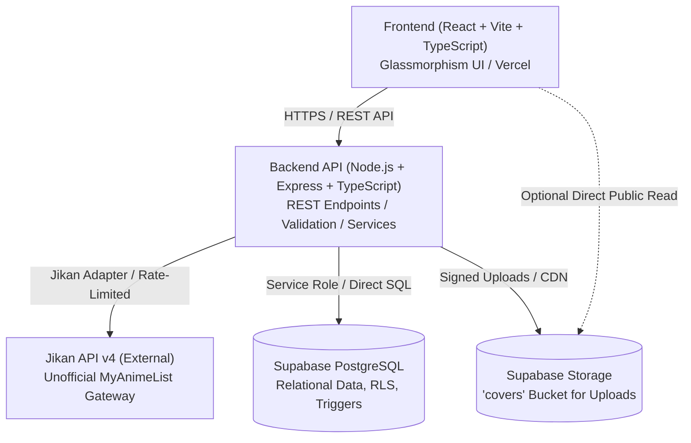
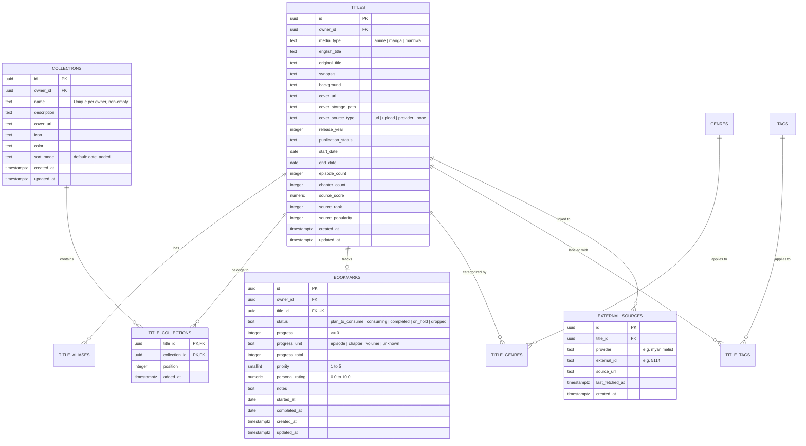
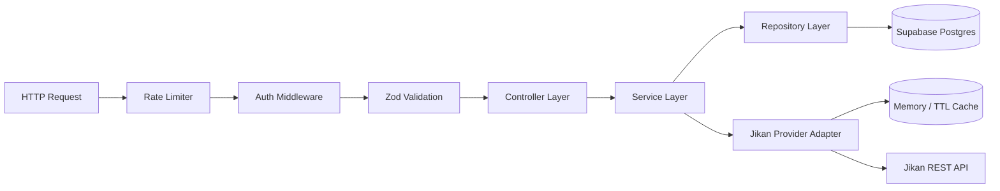

# AnimeManager — System Architecture

**Document Version:** 1.2  
**Status:** Layered Express REST Backend Implemented (Phase 02)  
**Implementation State:** Phase 01 & Phase 02 Complete (Database Schema, Express API, Owner Scoping, Tests)  


---

## 1. System Overview

AnimeManager (Personal Media Library) is designed as a private-first personal catalog and tracker for anime, manga, and manhwa. The system separates **Bookmarks** (user's consumption status, episode/chapter progress, rating, and notes) from **My List** (arbitrary user-defined thematic collections and folders).



### Key Architectural Tenets
1. **Separation of Concerns:** Business logic lives in backend services; UI components handle presentation and user interactions; database maintains referential integrity through foreign keys and constraints.
2. **Private-First Security:** The application is not an open public social platform. Access is restricted to the library owner; database tables enforce Row Level Security (RLS) or explicit backend authorization gates.
3. **Resilient Metadata Import:** External services (Jikan/MyAnimeList) can fail, be rate-limited, or change. All imported data passes through an editable preview draft before persistence, and manual entry remains fully functional independently.
4. **Data Ownership & Portability:** All metadata, collections, and progress records reside in the user's PostgreSQL database with full JSON and CSV export capabilities.

---

## 2. Monorepo Repository Structure

The project adopts a structured monorepo layout using npm workspaces:

```text
AnimeManager/
├── apps/
│   ├── web/                         # Frontend Application (React, Vite, TS)
│   │   ├── src/
│   │   │   ├── app/                 # Root app component, router, providers
│   │   │   ├── components/
│   │   │   │   ├── layout/          # Shell, Navigation, Header, MobileNav
│   │   │   │   ├── ui/              # Glassmorphism buttons, cards, dialogs, inputs
│   │   │   │   ├── media/           # Poster cards, media badges, cover artwork
│   │   │   │   ├── collections/     # Collection cards, pickers, managers
│   │   │   │   ├── bookmarks/       # Status tabs, progress sliders, rating stars
│   │   │   │   ├── forms/           # Manual title form, collection form
│   │   │   │   └── import/          # Jikan search, preview, field selector
│   │   │   ├── features/            # Feature modules (titles, collections, bookmarks, search)
│   │   │   ├── hooks/               # Custom React hooks
│   │   │   ├── lib/                 # API client, query client, utilities
│   │   │   ├── styles/              # Design tokens, glassmorphism CSS, animations
│   │   │   └── types/               # Frontend-specific types
│   │   ├── index.html
│   │   ├── package.json
│   │   └── vite.config.ts
│   │
│   └── api/                         # Backend REST API (Node.js, Express, TS)
│       ├── src/
│       │   ├── app.ts               # Express application setup & middleware
│       │   ├── server.ts            # HTTP server entry point
│       │   ├── config/              # Environment variables & runtime validation
│       │   ├── routes/              # Express route definitions
│       │   ├── controllers/         # HTTP request/response handlers
│       │   ├── services/            # Core business logic
│       │   │   ├── titles/          # Title creation, update, query logic
│       │   │   ├── collections/     # Collection & membership logic
│       │   │   ├── bookmarks/       # Bookmark & progress tracking logic
│       │   │   └── import/          # Jikan adapter, normalizer, draft preview
│       │   ├── repositories/        # Database queries (Supabase client/pg)
│       │   ├── middleware/          # Validation, error handling, auth, rate limiting
│       │   ├── schemas/             # Zod validation schemas
│       │   └── errors/              # AppError classes & error catalog
│       ├── package.json
│       └── tsconfig.json
│
├── packages/
│   └── shared/                      # Shared types, constants, and Zod schemas
│       ├── src/
│       │   ├── types/               # Title, Bookmark, Collection, Jikan types
│       │   ├── schemas/             # Shared validation schemas
│       │   └── constants/           # Status enums, media type enums
│       ├── package.json
│       └── tsconfig.json
│
├── supabase/
│   ├── migrations/                  # Versioned SQL migrations (schema, RLS, triggers)
│   ├── seed.sql                     # Development seed fixtures
│   └── config.toml                  # Supabase local CLI configuration
│
├── docs/                            # Project documentation & build tracking
│   ├── BUILD_PROGRESS.md
│   ├── architecture.md
│   ├── api-contracts.md
│   ├── decisions.md
│   ├── test-report.md
│   ├── requirements-traceability.md
│   ├── deployment.md
│   └── known-limitations.md
│
├── Documentations/                  # Original client prompt and specifications (Immutable)
├── .env.example                     # Environment template with safe placeholders
├── .gitignore                       # Standard version control ignore rules
├── package.json                     # Root monorepo workspace configuration
└── README.md                        # Project onboarding and developer documentation
```

---

## 3. Data Architecture & Database Schema

The database is built on **Supabase PostgreSQL**. Relational integrity, check constraints, foreign keys with cascade deletions, and automated timestamps are enforced at the database layer.



### Constraints & Indexes
- `media_type`: Check constraint in `('anime', 'manga', 'manhwa')`.
- `bookmark.status`: Check constraint in `('plan_to_consume', 'consuming', 'completed', 'on_hold', 'dropped')`.
- `bookmark.progress`: Non-negative integer check (`progress >= 0`).
- `bookmark.personal_rating`: Numeric check between `0.0` and `10.0`.
- Unique constraint on `(owner_id, title_id)` on `bookmarks` (one bookmark per title per user).
- Unique constraint on `(owner_id, lower(name))` on `collections` (prevents case-insensitive duplicate names).
- Composite primary key on `title_collections(title_id, collection_id)`.
- Unique constraint on `(provider, external_id)` on `external_sources`.
- Trigram / B-tree indexes on `titles(english_title)`, `title_aliases(alias)`, `bookmarks(owner_id, status)`, `titles(owner_id, media_type)`.

---

## 4. Backend Architecture (Express API)

The backend follows a layered architecture to maintain clear boundaries:



### Layers (Implemented in Phase 02):
1. **Routing & Middleware (`apps/api/src/middleware/`):**
   - Helmet security headers with restrictive CSP policies, CORS configured via environment variables.
   - Request ID attribution via `request-id.middleware.ts` generating or preserving `X-Request-ID`.
   - Authentication middleware (`auth.middleware.ts`) verifying Supabase JWT tokens via `jsonwebtoken` against `SUPABASE_JWT_SECRET`. Rejects missing, malformed, invalid, or expired tokens with HTTP 401. Derives authenticated `owner_id` and attaches to `req.user`.
   - Zod validation middleware (`validation.middleware.ts`) validating request `body`, `query`, and `params` against Zod schemas, returning standard HTTP 422 `VALIDATION_ERROR` envelopes.
   - Centralized error handler (`error.middleware.ts`) mapping `AppError` subclasses (`ValidationError`, `UnauthorizedError`, `ForbiddenError`, `NotFoundError`, `ConflictError`, `DatabaseError`) to stable error codes, suppressing stack traces and sensitive connection strings in production.
2. **Controllers (`apps/api/src/controllers/`):**
   - Pure request/response handlers: `health.controller.ts`, `titles.controller.ts`, `collections.controller.ts`, `bookmarks.controller.ts`.
   - Formats responses using standard JSON envelope `{ data, meta }` or `{ data, pagination, meta }`.
3. **Services (`apps/api/src/services/`):**
   - Core domain business logic and validation: `titles.service.ts`, `collections.service.ts`, `bookmarks.service.ts`.
   - Strictly enforces owner isolation; guarantees cross-owner titles cannot be attached to another user's collection or bookmarked.
   - Enforces progress bounds (`0 <= progress <= progressTotal`) and personal rating bounds (`0.0 <= personalRating <= 10.0`).
4. **Repositories (`apps/api/src/repositories/`):**
   - Database connection pooling managed via `db.ts` with `pg.Pool`.
   - Fully parameterized queries protecting against SQL injection.
   - `db.transaction()` executes multi-table mutations (such as title creation with aliases, genres, and tags) inside atomic transactions, rolling back upon error.
   - `titles.repository.ts`, `collections.repository.ts`, `bookmarks.repository.ts` manage relational SQL operations.
5. **Jikan Adapter (`apps/api/src/services/import/`):**
   - Implemented in Phase 03:
     - `url-parser.ts`: Strict SSRF-safe URL parser for MyAnimeList URLs (`https://myanimelist.net/anime/{id}` and `/manga/{id}`). Validates protocol, hostname, port, and path shape.
     - `cache.ts`: `BoundedTtlCache` implementing TTL expiration (10m default) and LRU eviction (500 entries max) to prevent unbounded memory growth.
     - `throttler.ts`: `RequestThrottler` enforcing ~3 req/s spacing between outbound upstream requests.
     - `jikan.client.ts`: Resilient HTTP client with bounded exponential backoff for HTTP 429 and 503, honoring `Retry-After`, 10s request timeout, `redirect: 'error'`, non-retryable 4xx rejection, and test fetch injection hooks.
     - `normalizer.ts`: Maps upstream payloads into domain `ImportDraft`. Classifies explicit manhwa, flags ambiguous manga/manhwa with warnings and `needsMediaConfirmation`, deduplicates aliases/genres/tags, and strictly excludes community reviews.
     - `import.service.ts`: Orchestrates candidate search, read-only preview with duplicate detection against `external_sources`, and atomic transactional commit enforcing server-side field selection.

---

## 5. Frontend Architecture (React + Vite)

### Technology Stack:
- **Core:** React 18+, Vite, TypeScript.
- **Routing:** React Router v6+.
- **State & Caching:** TanStack Query (React Query) for server state; local React state for UI interactions.
- **Forms & Validation:** React Hook Form with `@hookform/resolvers/zod`.
- **Icons:** Lucide React.
- **Styling:** Vanilla CSS with design tokens and CSS custom properties (glassmorphism tokens, backdrop filters, translucent surfaces, and accessibility contrast fallbacks).

### Key Pages & Navigation:
- **Primary Routes:**
  - `/` — Library Dashboard (Quick stats, recently updated bookmarks, recent additions, collection shortcuts).
  - `/my-list` — Collections Overview (Grid of user-created folders).
  - `/collections/:collectionId` — Collection View (Titles belonging to this collection with custom sorting).
  - `/bookmarks` — Bookmarks Tracker (Status tabs: Plan to Watch/Read, In Progress, Completed, On Hold, Dropped).
  - `/titles/new` — Add Title Selector (Manual Entry or Import).
  - `/titles/import` — Jikan Importer (URL, MAL ID, Search with interactive preview & field selector).
  - `/titles/:titleId` — Title Details (Full metadata, cover artwork, bookmarks editor, collections manager, external links).
  - `/titles/:titleId/edit` — Edit Title.
  - `/settings` — Preferences, JSON/CSV export, health status.

---

## 6. Jikan Integration & SSRF Protection

### URL Safety Architecture & SSRF Defenses:
To eliminate Server-Side Request Forgery (SSRF) vulnerabilities, the application **never** performs direct HTTP fetches of user-supplied URLs or passes user input to fetch handlers:
1. **Strict WHATWG URL Parsing:**
   - URLs are parsed using the standard WHATWG `URL` class (`apps/api/src/services/import/url-parser.ts`).
   - Rejects non-HTTPS protocols (`http:`, `ftp:`, `file:`, `javascript:`, etc.).
   - Exact hostname validation: Hostname must be strictly `myanimelist.net`. Alternate domains, lookalikes (`myanlmelist.net`, `myanimelist.net.evil.com`), IP addresses (`127.0.0.1`, `169.254.169.254`, IPv6 `::1`), and localhost are rejected with HTTP 400.
   - Enforces default port 443 (or empty port); rejects URLs with custom ports (`:8080`, `:22`).
   - Rejects URLs containing authentication credentials (`user:pass@...`).
   - Pathname validation: Must strictly match `^\/(anime|manga)\/(\d+)(?:\/[^\/]+)?\/?$`. Only positive numeric IDs are accepted.
   - Trailing slashes are permitted, optional title slugs are safely parsed, and query parameters (`?query=...`) and hash fragments (`#fragment`) are safely discarded without altering the parsed ID or media type.
2. **Fixed Upstream Base URL Construction:**
   - Outbound HTTP requests are built strictly from the immutable constant `https://api.jikan.moe/v4/{endpoint}`.
   - Client-supplied URLs are never passed to the HTTP client.
   - Client redirect policy: `redirect: 'error'` ensures the HTTP client refuses to follow automatic redirects to arbitrary hosts.

### Import Resilience & Upstream Protection:
- **Timeouts:** Configurable request timeout with 10-second default using `AbortSignal.timeout(10000)`.
- **Request Throttler:** `RequestThrottler` enforces a serialized inter-request delay (~334ms spacing, ~3 req/s) to comply with Jikan's published rate limits.
- **Bounded In-Memory Caching:** `BoundedTtlCache` stores successful candidate search and full detail responses (10m TTL default) with LRU capacity eviction (500 entries max) to prevent unbounded memory growth. Failed requests are never cached as successes.
- **Transient Error Retries:** Bounded exponential backoff (initial delay 500ms, backoff factor 2, max 3 retries, capped at 10s wait) applies exclusively to transient HTTP 429 (Too Many Requests) and HTTP 503 (Service Unavailable).
- **`Retry-After` Header:** Honors standard numeric seconds and HTTP-date formats up to the maximum bounded wait time.
- **Non-Retryable Errors:** Client errors (400, 404, etc.) fail immediately without retries.
- **Decoupled Architecture:** If Jikan is unavailable, manual title creation, collection management, and bookmark tracking remain completely operational without interruption.

### Normalization & Atomic Commit:
- **Manga vs. Manhwa:** Automatically sets `mediaType: "manhwa"` when source `type` explicitly equals `"Manhwa"`. For ambiguous manga entries, flags `needsMediaConfirmation: true` and includes a warning requiring the user to verify the classification before saving.
- **Community Review Exclusion:** Community reviews are never retrieved or stored.
- **Server-Enforced Field Selection:** The client can preview and select fields (`selectedFields`), but the server revalidates and enforces which fields are written to the database. Unselected fields default to `null` or empty arrays.
- **Transactional Persistence:** Persistence runs inside `db.transaction()`, atomically inserting title, aliases, genres, tags, external source link, initial bookmark, and collection memberships. Any failure triggers an automatic rollback. Duplicate MAL IDs for the same user return HTTP 409 `DUPLICATE_IMPORT` with the existing title ID.

---

## 7. Storage & Cover Artwork Management

- **External Cover URLs:** Titles can reference verified external image URLs (e.g. MAL CDN images).
- **Uploaded Cover Images:** Stored in the Supabase Storage bucket `covers`.
  - Max file size: 5 MB (configurable).
  - Allowed MIME types: `image/jpeg`, `image/png`, `image/webp`.
  - Upload paths are generated server-side using UUIDs (`/covers/{owner_id}/{title_id}_{uuid}.webp`) to prevent path traversal.
  - Image fallback component displays a styled glassmorphic placeholder when no image exists or if an external image fails to load.
