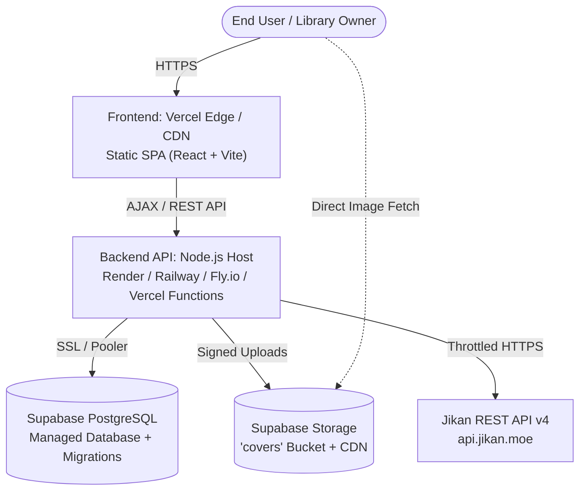

# AnimeManager — Deployment & Operations Guide

**Document Version:** 1.0  
**Phase:** Phase 00 (Baseline)  
**Status:** Planned / Pending Phase 07 Deployment  

---

## 1. Hosting Architecture & Target Infrastructure

AnimeManager follows a decoupled deployment architecture designed for high availability, security, and low operational overhead:



### Hosting Targets:
1. **Frontend:** Deployed to **Vercel** as a high-performance static SPA build with edge routing.
2. **Backend API:** Deployed as a dedicated containerized Node.js service (e.g. Render, Railway, Fly.io) or as a Vercel Serverless Function entry point.
3. **Database & Object Storage:** Hosted on **Supabase** (PostgreSQL 15+ and Supabase Storage S3-compatible service).

---

## 2. Environment Variables & Secret Management

### 2.1 Frontend Variables (`apps/web/.env`)
Only variables prefixed with `VITE_` are bundled into the client build. No secrets must ever exist here.

| Variable Name | Required | Example / Default | Description |
|---|---|---|---|
| `VITE_API_BASE_URL` | Yes | `https://api.animemanager.example.com/api/v1` | Public URL of the backend API. |
| `VITE_APP_TITLE` | No | `AnimeManager` | Display name in application headers. |

### 2.2 Backend Variables (`apps/api/.env`)
Kept strictly server-side. Never exposed to version control or the client bundle.

| Variable Name | Required | Example / Default | Description |
|---|---|---|---|
| `NODE_ENV` | Yes | `production` / `development` | Node runtime environment. |
| `PORT` | Yes | `4000` | Port for the Express HTTP server. |
| `DATABASE_URL` | Yes | `postgresql://postgres:[PASSWORD]@[HOST]:5432/postgres` | PostgreSQL connection string. |
| `SUPABASE_URL` | Yes | `https://[PROJECT_ID].supabase.co` | Supabase project endpoint. |
| `SUPABASE_SERVICE_ROLE_KEY` | Yes | `eyJh...` | High-privilege key for server-side operations and storage management. |
| `SUPABASE_JWT_SECRET` | Yes | `super-secret-jwt-key` | Secret used to verify caller authentication tokens. |
| `JIKAN_BASE_URL` | No | `https://api.jikan.moe/v4` | Upstream Jikan endpoint URL. |
| `REQUEST_TIMEOUT_MS` | No | `10000` | Outbound request timeout limit (default: 10s). |
| `IMPORT_RATE_LIMIT_WINDOW_MS`| No | `60000` | Rate limit window for import calls (60s). |
| `IMPORT_RATE_LIMIT_MAX` | No | `20` | Max import requests per minute per IP. |
| `COVER_MAX_BYTES` | No | `5242880` | Max file upload size (default: 5 MB). |
| `CORS_ORIGIN` | Yes | `https://animemanager.vercel.app` | Allowed frontend origin for CORS headers. |

---

## 3. Storage Bucket Configuration (Supabase)

The cover artwork storage bucket must be provisioned with the following parameters:
- **Bucket Name:** `covers`
- **Public Access:** Enabled for public read (or scoped via signed URLs if strict privacy is chosen).
- **File Size Limit:** `5242880` bytes (5 MB).
- **Allowed MIME Types:** `image/jpeg`, `image/png`, `image/webp`.
- **Upload Policies:** Insert and delete restricted strictly to authenticated users / service role.

---

## 4. Production Release Checklist (Phase 07)

- [ ] All automated tests pass (`npm test`, `npm run test:e2e`).
- [ ] TypeScript check clean with zero errors (`npm run typecheck`).
- [ ] ESLint clean with zero warnings/errors (`npm run lint`).
- [ ] No secrets or `.env` files committed to Git.
- [ ] Supabase migrations applied to production database.
- [ ] Supabase RLS policies verified on production tables.
- [ ] Storage bucket `covers` initialized with upload limits.
- [ ] CORS origins set strictly to production frontend domain.
- [ ] `/api/v1/health` endpoint responds with 200 OK.
- [ ] Manual import and cover upload smoke tested on production URL.
- [ ] JSON backup export tested and validated.

---

## 5. Rollback Procedures

### 5.1 Frontend Rollback (Vercel)
1. Navigate to the Vercel Project Dashboard.
2. Select the **Deployments** tab.
3. Locate the previous stable deployment.
4. Click **Instant Rollback** to promote the previous build to production.
5. Verify frontend availability.

### 5.2 Backend API Rollback
1. If using a container platform (Render/Railway), trigger a rollback to the previous commit SHA or redeploy the prior successful image tag.
2. If using Vercel Serverless Functions, rolling back the Vercel deployment automatically rolls back the associated API functions.

### 5.3 Database Migration Recovery
- All migrations in `supabase/migrations/` must include corresponding down-migration/recovery notes.
- In the event of a faulty migration, apply the designated compensating down-migration script via the Supabase CLI:
  ```shell
  npx supabase db push
  ```
- If data corruption occurs, restore from the automated daily Supabase backup or import from a pre-deployment JSON export snapshot.
