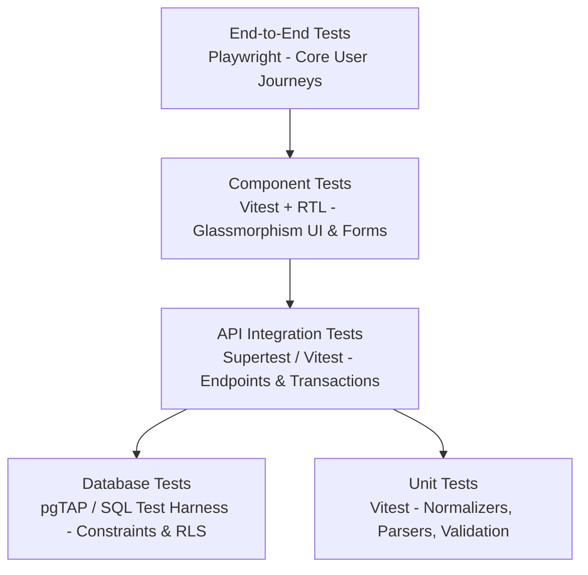

# AnimeManager — Verification & Test Report

**Document Version:** 1.0  
**Phase:** Phase 00 (Workspace Inspection & Project Setup)  
**Date:** 2026-10-14  

---

## 1. Executive Summary

This document serves as the authoritative, ongoing record of all automated test suites, linting checks, type-checking runs, and manual verification procedures.

During **Phase 00**, the workspace was inspected from a clean state. No application code or build configurations exist yet. Consequently, code verification checks (lint, typecheck, unit tests, build) are accurately recorded as **NOT RUN / NOT APPLICABLE**. System environment prerequisites (Node.js, npm, Git) and directory states were verified and recorded with actual command results below.

---

## 2. Phase 00 Baseline Verification Results

| Check Category | Command Executed | Expected Outcome | Actual Result | Status |
|---|---|---|---|---|
| **Workspace Cleanliness** | `ls -la && git status` | Directory empty apart from `Documentations/`; non-git status | Clean directory with 1 subdirectory (`Documentations`); no `.git` | **PASS** |
| **Node.js Environment** | `node -v` | Node.js runtime installed (v20+ LTS or current) | `v26.10.0` | **PASS** |
| **npm Environment** | `npm -v` | npm package manager installed | `11.19.1` | **PASS** |
| **Git Environment** | `git --version` | Git version control installed | `git version 2.55.0` | **PASS** |
| **Linting Check** | `npm run lint` | ESLint verification of codebase | Not runnable (package scaffold not yet initialized) | **NOT RUN / NOT APPLICABLE** |
| **TypeScript Check** | `npm run typecheck` | TypeScript compilation without errors | Not runnable (tsconfig not yet initialized) | **NOT RUN / NOT APPLICABLE** |
| **Automated Tests** | `npm test` | Vitest / Jest test runner execution | Not runnable (test runner not yet installed) | **NOT RUN / NOT APPLICABLE** |
| **Production Build** | `npm run build` | Vite and Express bundle builds | Not runnable (build config not yet initialized) | **NOT RUN / NOT APPLICABLE** |

---

## 3. Actual Command Execution Logs (Phase 00)

### 3.1 Workspace Inspection & Git Check
```shell
$ ls -la && git status
total 0
drwxr-xr-x@  3 ragnar  staff   96 Oct 14 14:51 .
drwxr-xr-x@ 17 ragnar  staff  544 Oct 14 14:51 ..
drwxr-xr-x@  5 ragnar  staff  160 Oct 14 14:51 Documentations
fatal: not a git repository (or any of the parent directories): .git
# Exit code: 128 (as expected for uninitialized git repo)
```

### 3.2 Toolchain Versions
```shell
$ node -v && npm -v && git --version
v26.10.0
11.19.1
git version 2.55.0
# Exit code: 0
```

---

## 4. Planned Testing Matrix (Phases 01–07)

When the application scaffold is initialized in Phase 01 and onward, the test strategy spans multiple automated layers:



### 4.1 Unit Tests (Vitest)
- [ ] **URL Parser:** Verify extraction of MAL ID and media type from valid MAL URLs; rejection of malformed or arbitrary URLs.
- [ ] **Jikan Normalizer:** Verify mapping of Jikan v4 payloads into internal `TitleImportDraft`; handling of missing fields, null images, unknown publication dates.
- [ ] **Bookmark Progress Rules:** Verify progress non-negativity check; validation when progress exceeds total count.
- [ ] **Validation Schemas:** Zod schemas for manual title, collection name trimming, rating bounds.

### 4.2 Database & Migration Tests
- [ ] Verify clean execution of SQL migrations on fresh PostgreSQL database.
- [ ] Verify foreign key cascade behavior (deleting title deletes bookmark & memberships; deleting collection leaves title intact).
- [ ] Verify check constraints (`media_type`, `status`, `personal_rating` 0–10).
- [ ] Verify Row Level Security (RLS) policies prevent cross-owner data mutation.

### 4.3 API Integration Tests (Supertest)
- [ ] Health endpoint (`GET /api/v1/health`) returns 200 and database status.
- [ ] Title CRUD endpoints (`GET`, `POST`, `PATCH`, `DELETE /api/v1/titles`).
- [ ] Collection membership endpoints (`POST /api/v1/collections/:id/titles`, `DELETE`).
- [ ] Bookmark tracking endpoints (`GET`, `POST`, `PATCH /api/v1/bookmarks`).
- [ ] Jikan mock integration tests: simulated 200 success, 429 rate limit, 500 error, and network timeout.

### 4.4 End-to-End Tests (Playwright)
- [ ] **Journey A:** Create custom collection and verify listing.
- [ ] **Journey B:** Manually add anime title and add to collection.
- [ ] **Journey C:** Import title via MAL URL, preview editable fields, select fields, and commit.
- [ ] **Journey D:** Update bookmark tracking status, progress count, and personal rating.
- [ ] **Journey E:** Add title to multiple collections; remove from one collection without affecting the other.
- [ ] **Export Verification:** Trigger JSON export and verify JSON structure integrity.

---

## 5. Standard Verification Commands (Post-Scaffold)

Once Phase 01 creates the project scaffold, the following reproducible scripts will be enforced:

```shell
# Run ESLint across all workspaces
npm run lint

# Run TypeScript type check across all workspaces
npm run typecheck

# Run unit and integration tests
npm test

# Run Playwright end-to-end tests
npm run test:e2e

# Run complete build for all packages and apps
npm run build
```
