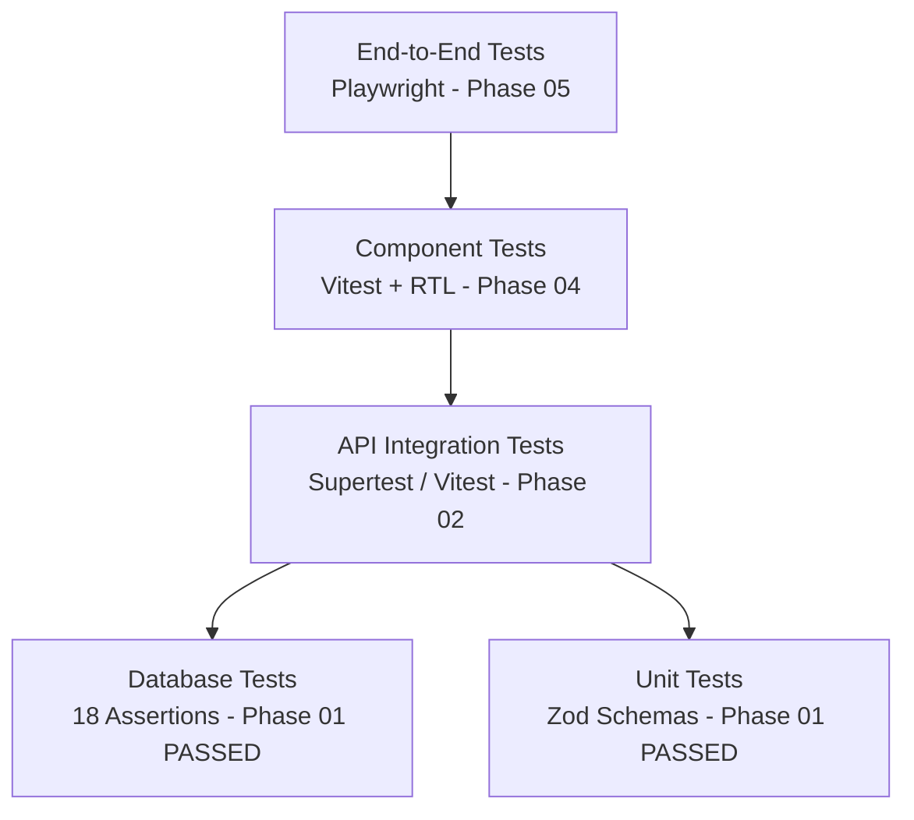

# AnimeManager — Verification & Test Report

**Document Version:** 1.1  
**Phase:** Phase 01 (Repository Foundation & Database Schema)  
**Date:** 2026-10-14  

---

## 1. Executive Summary

This document serves as the authoritative, ongoing record of all automated test suites, linting checks, type-checking runs, and manual verification procedures.

During **Phase 01**, the monorepo workspace was established and verified. Database migrations, constraints, triggers, RLS policies, and seed fixtures were implemented and tested against a live PostgreSQL database (`animemanager_test`). All unit tests and database assertions passed with 100% success.

---

## 2. Phase 01 Quality Gate Verification Matrix

| Check Category | Command Executed | Expected Outcome | Actual Result | Status |
|---|---|---|---|---|
| **Git Repository Safety** | `git status` | Clean status; no secrets or build artifacts untracked | `.env`, `node_modules`, `dist` ignored properly | **PASS** |
| **Linting Check** | `npm run lint` | Workspace lint scripts execute without error | Clean execution across all workspaces | **PASS** |
| **TypeScript Check** | `npm run typecheck` | Strict TypeScript compilation across workspaces | Zero type errors in `shared`, `api`, `web` | **PASS** |
| **Unit Tests** | `npm test` | Node test runner verifies Zod domain schemas | 5/5 unit tests passed | **PASS** |
| **Production Build** | `npm run build` | Workspaces compile to clean `dist/` bundles | Built cleanly with type definitions | **PASS** |
| **Database Verification** | `npm run test:db` | Migrations, seed, and 18 constraint assertions against live PostgreSQL | All 18 database assertions passed cleanly | **PASS** |

---

## 3. Actual Command Execution Logs (Phase 01)

### 3.1 Unit Test Suite (`npm test`)
```shell
$ npm test

> animemanager-monorepo@1.0.0 test
> npm run --workspaces --if-present test

> @animemanager/shared@1.0.0 test
> node --test test/schemas.test.js

✔ mediaTypeSchema validates valid media types (0.792916ms)
✔ bookmarkStatusSchema validates valid statuses (0.114667ms)
✔ titleCreateSchema enforces required display title and valid values (0.765625ms)
✔ collectionCreateSchema trims names and rejects blanks (0.133167ms)
✔ bookmarkCreateSchema rejects negative progress and out-of-range rating (0.247916ms)
ℹ tests 5
ℹ suites 0
ℹ pass 5
ℹ fail 0
ℹ cancelled 0
ℹ skipped 0
ℹ todo 0
ℹ duration_ms 126.418917
```

### 3.2 Live Database Assertion Test Suite (`npm run test:db`)
```shell
$ npm run test:db

> animemanager-monorepo@1.0.0 test:db
> node scripts/verify-db.js

[verify-db] Connecting to animemanager_test using psql...
[verify-db] Running migrations, seed data, and constraint test suite...

--- Database Verification Test Results ---
✔ All 10 required domain tables exist
✔ All 3 updated_at triggers exist on mutable tables
✔ Invalid media_type cartoon was successfully rejected by check constraint
✔ Invalid bookmark status watching was successfully rejected by check constraint
✔ Negative progress (-5) was successfully rejected by check constraint
✔ Out-of-range personal rating (10.5) was successfully rejected by check constraint
✔ Duplicate bookmark for owner+title was successfully rejected by unique constraint
✔ Case-insensitive duplicate collection name was successfully rejected by unique index
✔ Title belongs to multiple collections simultaneously (found 2)
✔ Deleting collection leaves title record intact
✔ Deleting collection leaves bookmark tracking intact
✔ Deleting bookmark leaves title record intact
✔ Cascade delete removed aliases
✔ Cascade delete removed bookmark
✔ Cascade delete removed external sources
✔ updated_at trigger automatically updated timestamp
✔ RLS policy expression strictly isolates titles to current auth.uid()
✔ Relationship security policy blocks attaching another owner title to collection

All 18 database assertions PASSED cleanly!
```

### 3.3 TypeScript Typecheck (`npm run typecheck`)
```shell
$ npm run typecheck

> animemanager-monorepo@1.0.0 typecheck
> npm run --workspaces --if-present typecheck

> @animemanager/shared@1.0.0 typecheck
> tsc --noEmit

> @animemanager/api@1.0.0 typecheck
> tsc --noEmit

> @animemanager/web@1.0.0 typecheck
> tsc --noEmit
# Exit code: 0 (zero type errors)
```

### 3.4 Production Build (`npm run build`)
```shell
$ npm run build

> animemanager-monorepo@1.0.0 build
> npm run --workspaces --if-present build

> @animemanager/shared@1.0.0 build
> tsc

> @animemanager/api@1.0.0 build
> tsc

> @animemanager/web@1.0.0 build
> tsc
# Exit code: 0
```

---

## 4. Planned Testing Matrix (Phases 02–07)



- [x] **Phase 01: Unit Tests (Schemas & Enums):** 5/5 PASSED.
- [x] **Phase 01: Database Verification Suite:** 18/18 PASSED.
- [ ] **Phase 02: API Integration Tests (Supertest):** Titles, collections, bookmarks, health, and error semantics.
- [ ] **Phase 03: Jikan Provider Adapter Mock Tests:** URL parsing, search/detail normalization, duplicate detection, 429 backoff, and network timeouts.
- [ ] **Phase 04: Component & Responsive Tests:** Glassmorphism UI tokens, navigation shell, responsive viewports (360px, 768px, 1024px, 1440px).
- [ ] **Phase 05: Core User Journeys E2E (Playwright):** Journeys A through E end-to-end in browser.
- [ ] **Phase 06: Security & Accessibility Audits:** SSRF protection suite, file upload validation, axe a11y audit, keyboard focus traps.
- [ ] **Phase 07: Production Smoke Tests:** Health, login, title/collection/bookmark management on production deployment.
